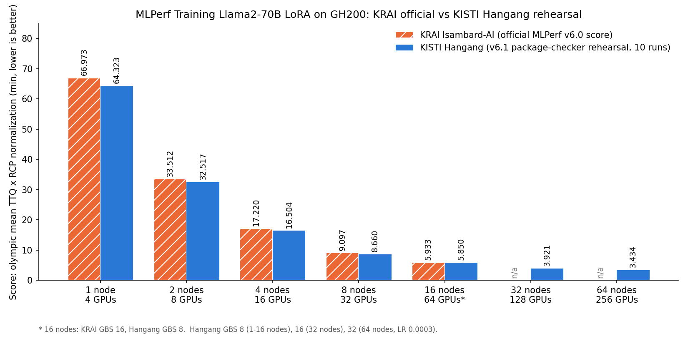
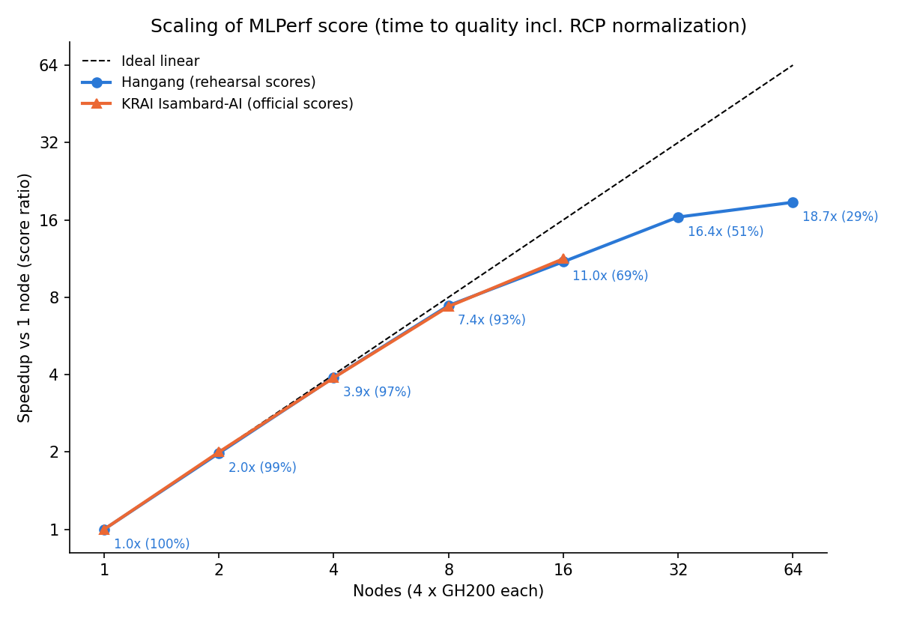

# MLPerf Training Llama2-70B LoRA on a GH200 Supercomputer

Reproducible recipe for running the **MLPerf Training Llama2-70B LoRA** benchmark on
**KISTI's 6th supercomputer "Hangang"** (NVIDIA GH200, HPE Slingshot) from 1 to 64 nodes
(4 to 256 GPUs), using the same software stack that KRAI used for its official MLPerf Training
v6.0 submission on **Isambard-AI** (GH200, Slingshot), and preparing an official-style
submission package that passes the MLPerf Training **v6.1** package checker.

<p align="center"></p>

## Results: official-submission rehearsal

Ten runs per scale, scored exactly like an MLPerf submission: mean time to quality (TTQ)
without the fastest and slowest run, times the RCP normalization factor computed by the MLPerf
package checker (`mlperf-logging`, training ruleset 6.1.0). All seven scales pass the checker.

| Nodes | GPUs | Config | GBS | RCP norm. | **Hangang score** | KRAI official score | Hangang vs KRAI |
|---:|---:|---|---:|---:|---:|---:|---:|
| 1 | 4 | Krai n1 | 8 | 1.0347 | **64.323 min** | 66.973 min | 4.0% faster |
| 2 | 8 | Krai n2 | 8 | 1.0347 | **32.517 min** | 33.512 min | 3.0% faster |
| 4 | 16 | Krai n4 | 8 | 1.0511 | **16.504 min** | 17.220 min | 4.2% faster |
| 8 | 32 | Krai n8 | 8 | 1.0347 | **8.660 min** | 9.097 min | 4.8% faster |
| 16 | 64 | Krai n16 (CP2) | 8 | 1.0034 | **5.850 min** | 5.933 min (GBS 16) | 1.4% faster |
| 32 | 128 | Hangang (CP2) | 16 | 1.0500 | **3.921 min** | n/a | |
| 64 | 256 | Hangang (CP2, LR 0.0003) | 32 | 1.0000 | **3.434 min** | n/a | |

> **Caveats.** This is a rehearsal, not an MLPerf submission: it was not reviewed by MLCommons
> and is not an official MLPerf result. KRAI numbers are KRAI's published MLPerf Training v6.0
> scores (including RCP normalization). The 16- and 32-node sets each contain one non-converged
> run, scored as the slowest run as the rules allow (see [docs/RESULTS.md](docs/RESULTS.md)).

<p align="center"></p>

## Key findings

1. **Same stack, same scaling as KRAI; Hangang is ~4% faster per node.** Scaling efficiency
   from official-style scores is nearly identical on both systems (Hangang 99/97/93/69% at
   2/4/8/16 nodes, KRAI 100/97/92/71%). Both systems use GH200 with 96 GB HBM3; the difference
   is most likely the power limit (900 W per GH200 on liquid-cooled Hangang vs a 660 W CPU+GPU
   cap on air-cooled Isambard-AI).
2. **Software parity mattered more than hardware.** A home-built container gave 72.5 min on
   1 node and *133.2 min on 2 nodes* (inverse scaling). Rebuilding the NVIDIA v5.0 image exactly
   and using KRAI's configs fixed it.
3. **Beyond 16 nodes the limit is convergence, not hardware.** The 64-node training throughput
   is ~40x the 1-node throughput, but the global batch must grow (or context parallelism must
   cross nodes), and the MLPerf Reference Convergence Points (RCP) require more samples at larger
   GBS. 64 nodes is only 12% faster than 32 nodes.
4. **RCP rules decide the 64-node configuration.** GBS 32 with KRAI's LR (0.00055) converged in
   4992 samples, below the RCP lower limit of 5802, so the package checker would reject it (the
   single-run 2.445 min in earlier versions of this README was not a valid score). LR 0.0003 with
   1024 max steps converged at 6144-6912 samples in the runs inspected and passes.
5. **CP2 `a2a` beats CP4 `p2p` at 32 nodes** (3.921 vs 4.319 min): `p2p` ring attention ran at
   ~78% of the throughput and converged later on average. With TP=4, CP>2 requires `p2p`
   because Llama2-70B has only 2 KV heads per TP rank.
6. **NCCL over Slingshot needs the host libfabric.** The image's EFA libfabric has no CXI
   provider, so NCCL falls back to TCP. For LoRA on 2 nodes that barely matters (1.3%), but
   CXI is ~15x faster for all-reduce and is used for all multi-node runs.

## Contents

```
.
├── env.sh                  # paths, Slurm settings, excluded nodes (edit first)
├── submit.sh               # one MLPerf run = one Slurm job: ./submit.sh NODES SEED=<n>
├── configs/                # Hangang configs for 32 and 64 nodes (+ README)
├── container/build_inside.sh
├── slurm/
│   ├── run_ttq.sbatch      # benchmark job: disclosure keys, cache state, Pyxis + torchrun
│   └── nccl_test.sbatch    # NCCL transport test: TCP socket vs Slingshot CXI
├── scripts/
│   ├── 00_fetch_sources.sh         # NVIDIA v5.0 + Krai v6.0 code and logs from MLCommons
│   ├── 01_import_base_image.sbatch # NGC pytorch:25.04-py3 (arm64) -> .sqsh
│   ├── 02_build_container.sh       # benchmark image on a login node
│   ├── 03_prepare_data.sh          # GovReport dataset + Llama2-70B NeMo checkpoint
│   ├── run_series.sh               # 10 runs, filling free job slots, unattended
│   ├── make_system_json.py         # MLPerf system descriptions
│   ├── assemble_package.sh         # results + implementation tree for one scale
│   ├── check_package.sh            # MLPerf package checker (v6.1)
│   └── scores.sh                   # olympic mean x RCP normalization per scale
├── tools/
│   ├── log_disclosure.py   # v6.1 mandatory keys + cache_clear (MLLOG lines)
│   ├── cache_state.sh      # per-node page-cache size before training
│   ├── ttq_status.py       # progress, throughput, eval loss, TTQ from logs
│   ├── gpu_check.py        # per-GPU GEMM sanity check
│   ├── krai_baseline.py    # recompute KRAI's scores from MLCommons logs
│   ├── nccl_bench.py       # all-reduce bandwidth test
│   └── make_figures.py
├── results/                # official_rehearsal.csv, exploration_runs.csv, KRAI baseline
└── docs/                   # OFFICIAL_REHEARSAL.md, RESULTS.md, TROUBLESHOOTING.md, VALIDATION.md
```

The dataset (~10 MB) and the checkpoint (~129 GiB) are **not** stored here; step 3 downloads them.

## Background

| | KRAI on Isambard-AI | This work on Hangang |
|---|---|---|
| Node | GH200, 4 per node | HPE Cray EX254n, GH200, 4 per node |
| GPU memory | 96 GB HBM3 | 96 GB HBM3 (`nvidia-smi` name "GH200 120GB" refers to 120 GB LPDDR5X per Grace) |
| Power / cooling | 660 W cap shared by CPU and GPU, air-cooled | 900 W per GH200, liquid-cooled |
| Interconnect | HPE Slingshot | HPE Slingshot 11, 4 Cassini NICs (200 Gb/s), Dragonfly, 104 nodes/group |
| Container runtime | podman-hpc | Enroot + Pyxis |
| Software | NVIDIA MLPerf Training v5.0 implementation + KRAI `train.py` | identical, rebuilt from the same recipe |
| Configs | KRAI v6.0 `config_gh200_n*` (1-16 nodes) | identical for 1-16 nodes; `configs/` for 32/64 |

KRAI's image (`krai4ai/mlperf-nvidia:llama2_70b_lora-pyt`) is not publicly pullable. Its
`train.py` differs from NVIDIA's v5.0 `nyx_n1_ngc25.04_nemo` in one line (`RANK` instead of
`SLURM_PROCID`, for torchrun), so this repo rebuilds the NVIDIA v5.0 image and mounts KRAI's
`train.py` at run time, as KRAI did.

## Benchmark at a glance

| Item | Value |
|---|---|
| Model | Llama2-70B, LoRA fine-tuning (FP8, NeMo 2 / Megatron-core) |
| Dataset | SCROLLS GovReport (MLPerf preprocessed), sequence length 8192 |
| Quality target | validation cross-entropy loss <= 0.925 (logged as `eval_accuracy`) |
| Evaluation | every 384 samples; first `floor(0.125*GBS + 2)` evaluations skipped |
| Metric | time to quality (TTQ) = `run_stop - run_start` |
| Score | 10 runs; mean without fastest and slowest; times RCP normalization; one non-converged run allowed |

## Reproduction on Hangang

All commands run from the repository root, which **must be under `/scratch`**. Every job
needs `--comment="field=...;appl=..."` (set in `env.sh`; see `showappl`). At most 5 jobs per
user can be queued or running.

### 0. Clone and configure

```bash
cd /scratch/$USER
git clone https://github.com/hwang2006/mlperf-training-llama2-lora-on-supercomputer.git
cd mlperf-training-llama2-lora-on-supercomputer
vi env.sh                     # CONT_DIR, DATA_BASE, JOB_COMMENT, EXCLUDE_NODES, SUBMITTER
chmod +x submit.sh scripts/*.sh scripts/*.py tools/*.sh tools/*.py
./scripts/00_fetch_sources.sh
```

### 1-3. Container and data

```bash
sbatch scripts/01_import_base_image.sbatch                       # ~10 min, compute node
nohup ./scripts/02_build_container.sh > results/build.log 2>&1 &  # ~30 min, aarch64 login node
./scripts/03_prepare_data.sh 2>&1 | tee results/data.log          # ~1 h, login node
```

| Component | Version |
|---|---|
| Base | `nvcr.io/nvidia/pytorch:25.04-py3` (PyTorch 2.7.0a0, CUDA 12.9) |
| Transformer Engine | 2.2.0 (base image, `TE_REVISION=SKIP`) |
| NeMo / Megatron-core | `25.04-alpha.rc1` (2.4.0rc0 / 0.12.0rc0) |
| NCCL / aws-ofi-nccl | 2.26.3 / 1.14.0 |
| MLPerf | mlperf-logging 5.0.0-rc2, mlperf-common, NeMo-Run (pinned commits) |

A plain rebuild of NVIDIA's Dockerfile today replaces the NGC PyTorch with a newer PyPI torch
(the Dockerfile disables NGC's pip constraints). `container/build_inside.sh` pins the NGC GPU
packages, resolves other dependencies as of 2025-05-01 (`uv --exclude-newer`) and aborts if
torch changes. If you already have the dataset and checkpoint, point `DATADIR` and `MODEL` to them.

### 4. Single runs

```bash
./submit.sh 2 SEED=2000                     # one run on 2 nodes (~37 min including startup)
python3 tools/ttq_status.py results/runs/kv6-ttq-<jobid>.out
```

`submit.sh` picks Krai's config for 1-16 nodes and the Hangang config for 32/64 nodes.
Startup (container, 129 GiB checkpoint load, warmup, CUDA graph capture) takes 4-10 min and
is not part of TTQ.

### 5. Official-style rehearsal: 10 runs, package, checker, score

```bash
setsid nohup ./scripts/run_series.sh 8 8000 > results/series-n8.log 2>&1 < /dev/null &
# ... when all 10 jobs have finished:
./scripts/assemble_package.sh 8 results/series-n8.jobs
./scripts/check_package.sh          # needs mlperf-logging for python3.12 (see docs)
./scripts/scores.sh
```

See [docs/OFFICIAL_REHEARSAL.md](docs/OFFICIAL_REHEARSAL.md) for the full procedure and the
MLPerf rules it implements, and [docs/VALIDATION.md](docs/VALIDATION.md) for a short test plan
for a fresh checkout.

## How a run is launched

```
sbatch (1 task per node, 36 CPUs, 4 GPUs)               one run = one job (cache flushed at job end)
 ├─ tools/log_disclosure.py                             v6.1 disclosure keys + cache_clear
 ├─ srun tools/cache_state.sh                           per-node page cache before training
 └─ srun --container-image=kv6-nv50-llama2lora-arm64.sqsh (Pyxis/Enroot, writable)
     └─ slurm2pytorch torchrun --nproc_per_node=4 --nnodes=N --rdzv_backend=c10d
         └─ train.py (KRAI v6.0) x 4 ranks per node     -> results/runs/<tag>-<jobid>/run.log
```

| Topic | Setting | Why |
|---|---|---|
| Slingshot RDMA (multi-node) | mount `/opt/cray` + host libfabric deps, `NCCL_NET_PLUGIN=aws-ofi`, `FI_PROVIDER=cxi` | image libfabric has no CXI provider |
| Single node | no Slingshot settings | Slurm allocates no VNI for 1 node; forcing CXI fails |
| v6.1 compliance | `log_disclosure.py` | the v5.0 code does not log the 9 keys mandatory since v6.1 |
| Cache flush | one run per job; ATOM `jobEnd` drops page and Lustre caches | MLPerf requires flushed caches before each run; no sudo needed |
| Read-only rootfs | `--container-writable`, `HF_HOME`/`HOME` on the results mount | NeMo writes `~/.cache` at startup |
| Compile caches | node-local `TRITON_CACHE_DIR` | a Lustre-shared Triton cache hung a 64-node run |
| Rendezvous | `--rdzv_conf=read_timeout=600,join_timeout=300` | container start time varies across nodes |
| Bad nodes | `EXCLUDE_NODES` | node0943 (interconnect setup), node1000-1007 (NaN from step 1) |

## Documentation

* [docs/OFFICIAL_REHEARSAL.md](docs/OFFICIAL_REHEARSAL.md): rules, procedure, package layout, submitting
* [docs/RESULTS.md](docs/RESULTS.md): all scores, run lists, design studies, NCCL tests
* [docs/TROUBLESHOOTING.md](docs/TROUBLESHOOTING.md): every error hit on Hangang and its fix
* [docs/VALIDATION.md](docs/VALIDATION.md): checks for a fresh checkout
* [configs/README.md](configs/README.md): 32/64-node configurations

## References

* MLCommons Training results: [v5.0](https://github.com/mlcommons/training_results_v5.0),
  [v6.0](https://github.com/mlcommons/training_results_v6.0)
* MLPerf Training rules: https://github.com/mlcommons/training_policies
* MLPerf logging and checkers: https://github.com/mlcommons/logging
* NVIDIA [Pyxis](https://github.com/NVIDIA/pyxis), [Enroot](https://github.com/NVIDIA/enroot); [aws-ofi-nccl](https://github.com/aws/aws-ofi-nccl)

## Acknowledgments

This work used the KISTI national supercomputer "Hangang" (project KSC-06-2026-BSM-00036).
Benchmark code and reference results are from NVIDIA, KRAI and MLCommons, used under their
respective licenses (Apache 2.0). MLPerf is a trademark of MLCommons; results here are not
verified by MLCommons.
