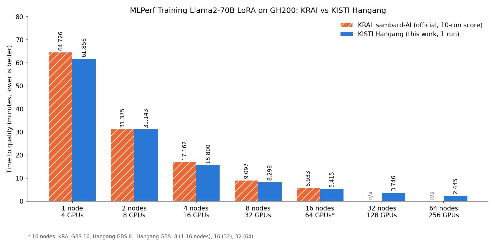

# MLPerf Training Llama2-70B LoRA on a GH200 Supercomputer

Reproducible recipe for running the **MLPerf Training Llama2-70B LoRA** benchmark on
**KISTI's 6th supercomputer "Hangang"** (NVIDIA GH200, HPE Slingshot), using the same
software stack that KRAI used for its official MLPerf Training v6.0 submission on
**Isambard-AI** (GH200, Slingshot), and scaling it from 1 to 64 nodes (4 to 256 GPUs).

<p align="center"></p>

## Highlights

| Nodes | GPUs | KRAI Isambard-AI (official) | KISTI Hangang (this work) | Hangang vs KRAI |
|---:|---:|---:|---:|---:|
| 1 | 4 | 64.726 min | **61.856 min** | 4.4% faster |
| 2 | 8 | 31.375 min | **31.143 min** | 0.7% faster |
| 4 | 16 | 17.162 min | **15.800 min** | 7.9% faster |
| 8 | 32 | 9.097 min | **8.298 min** | 8.8% faster |
| 16 | 64 | 5.933 min (GBS 16) | **5.415 min** (GBS 8) | 8.7% faster (different GBS) |
| 32 | 128 | n/a | **3.746 min** | |
| 64 | 256 | n/a | **2.445 min** | |

* Hangang matches or beats KRAI at every scale with the same container recipe and configs.
* Scaling efficiency (vs 1 node) on Hangang: 99% (2), 98% (4), 93% (8), 71% (16), 52% (32), 40% (64).
* Beyond 16 nodes the limiting factor is **convergence**, not hardware: the 64-node run
  trains at 2.0x the 32-node throughput but needs 30% more samples because GBS doubles.
* An earlier home-built container showed *inverse* scaling (72.5 min on 1 node, 133.2 min on
  2 nodes). Rebuilding the image exactly from the NVIDIA v5.0 recipe and using KRAI's
  configs fixed it.

> **Caveats.** Hangang numbers are single runs; KRAI numbers are official MLPerf scores
> (mean of 10 runs without fastest/slowest). These are not MLPerf submissions and were not
> reviewed by MLCommons. See [docs/RESULTS.md](docs/RESULTS.md) for full details.

## Contents

```
.
├── env.sh                         # all paths and Slurm settings (edit first)
├── submit.sh                      # submit a TTQ run: ./submit.sh NODES [KEY=VALUE ...]
├── container/build_inside.sh      # NVIDIA v5.0 Dockerfile steps, run inside enroot
├── scripts/
│   ├── 00_fetch_sources.sh        # NVIDIA v5.0 + KRAI v6.0 code from MLCommons (sparse)
│   ├── 01_import_base_image.sbatch# NGC pytorch:25.04-py3 (arm64) -> .sqsh
│   ├── 02_build_container.sh      # build the benchmark image on a login node
│   └── 03_prepare_data.sh         # GovReport dataset + Llama2-70B NeMo checkpoint
├── slurm/
│   ├── run_ttq.sbatch             # benchmark job (any node count, Pyxis + torchrun)
│   └── nccl_test.sbatch           # NCCL transport test: TCP socket vs Slingshot CXI
├── tools/
│   ├── ttq_status.py              # progress, throughput, eval loss, TTQ from logs
│   ├── krai_baseline.py           # recompute KRAI's official scores from MLCommons logs
│   ├── nccl_bench.py              # all-reduce bandwidth test
│   └── make_figures.py            # figures in docs/figures
├── results/                       # CSV of all runs (+ runs/ for your own logs, git-ignored)
└── docs/                          # RESULTS.md, TROUBLESHOOTING.md, figures
```

The dataset (~10 MB) and the checkpoint (~129 GiB) are **not** stored here; step 3
downloads them.

## Background

| | KRAI on Isambard-AI | This work on Hangang |
|---|---|---|
| GPU | GH200 96 GB, 4 per node | GH200 120 GB, 4 per node |
| CPU | NVIDIA Grace (aarch64) | NVIDIA Grace (aarch64) |
| Interconnect | HPE Slingshot | HPE Slingshot (4 x CXI NICs per node, `hsn0-3`) |
| Container runtime | podman-hpc | Enroot + Pyxis |
| Software | NVIDIA MLPerf Training v5.0 implementation + KRAI `train.py` | identical, rebuilt from the same recipe |
| Configs | KRAI v6.0 `config_gh200_n*` | identical for 1-16 nodes; own configs for 32/64 |

KRAI's image (`krai4ai/mlperf-nvidia:llama2_70b_lora-pyt`) is not publicly pullable.
Comparing its code with MLCommons results shows it is the NVIDIA MLPerf Training v5.0
`nyx_n1_ngc25.04_nemo` Dockerfile with a one-line change in `train.py`
(`RANK` instead of `SLURM_PROCID`, for torchrun). This repo rebuilds that image with enroot
and mounts KRAI's `train.py` at run time, exactly as KRAI did.

## Benchmark at a glance

| Item | Value |
|---|---|
| Model | Llama2-70B, LoRA fine-tuning (FP8, NeMo 2 / Megatron-core) |
| Dataset | SCROLLS GovReport (MLPerf preprocessed), sequence length 8192 |
| Quality target | validation cross-entropy loss <= 0.925 (logged as `eval_accuracy`) |
| Evaluation | every 384 samples; first `floor(0.125*GBS + 2)` evaluations skipped |
| Metric | time to quality (TTQ) = `run_stop - run_start` |
| Parallelism | TP=4 inside a node, DP across nodes, CP=2 from 16 nodes up |

## Reproduction on Hangang

All commands run from the repository root, which **must be under `/scratch`**
(Hangang's `cli_filter` rejects jobs submitted elsewhere). Every Slurm job also needs
`--comment="field=...;appl=..."`; the scripts use `field=efficientai;appl=megatron-lm`
(see `showappl` for allowed values).

### 0. Clone and configure

```bash
cd /scratch/$USER
git clone https://github.com/hwang2006/mlperf-training-llama2-lora-on-supercomputer.git
cd mlperf-training-llama2-lora-on-supercomputer
vi env.sh            # check CONT_DIR, DATA_ROOT, SLURM_COMMENT, CRAY_LIBFABRIC
chmod +x submit.sh scripts/*.sh
./scripts/00_fetch_sources.sh
```

### 1. Import the base image (compute node, ~10 min)

```bash
sbatch scripts/01_import_base_image.sbatch
# -> /scratch/$USER/containers/kv6-pytorch-25.04-py3-arm64.sqsh (~11 GB), IMPORT_EXIT=0
```

### 2. Build the benchmark image (login node, ~20-30 min)

Hangang login nodes are aarch64 and have Internet access, so the image is built there with
enroot (no Docker needed). The build reproduces the NVIDIA v5.0 Dockerfile:

| Component | Version |
|---|---|
| Base | `nvcr.io/nvidia/pytorch:25.04-py3` (PyTorch 2.7.0a0, CUDA 12.9) |
| Transformer Engine | 2.2.0 (from the base image, `TE_REVISION=SKIP`) |
| NeMo | `25.04-alpha.rc1` (2.4.0rc0, commit `3310699cbc`) |
| Megatron-core | `25.04-alpha.rc1` (0.12.0rc0, commit `cbc89b322`) |
| NCCL / aws-ofi-nccl | 2.26.3 / 1.14.0 (EFA libfabric inside the image) |
| MLPerf | mlperf-logging 5.0.0-rc2, mlperf-common, NeMo-Run (pinned commits) |

```bash
nohup ./scripts/02_build_container.sh > results/kv6-build.log 2>&1 &
tail -f results/kv6-build.log      # look for "FINAL torch 2.7.0a0..." and BUILD_EXIT=0
# -> /scratch/$USER/containers/kv6-nv50-llama2lora-arm64.sqsh (~12 GB)
```

**Important:** a plain rebuild of the Dockerfile today silently replaces the NGC PyTorch
with torch 2.x from PyPI (because the Dockerfile disables NGC's pip constraints), which
breaks Transformer Engine. `container/build_inside.sh` pins the NGC GPU packages and
resolves all other dependencies as of 2025-05-01 with `uv --exclude-newer`, and aborts if
the torch version changes.

### 3. Download data and checkpoint (login node, ~30-60 min)

```bash
./scripts/03_prepare_data.sh 2>&1 | tee results/kv6-data.log
```

| Path | Content | Source (Hugging Face) |
|---|---|---|
| `$DATADIR` | `train.npy`, `validation.npy` | `regisss/scrolls_gov_report_preprocessed_mlperf_2` |
| `$MODEL` | `context/`, `weights/` (NeMo 2 dist. checkpoint, ~129 GiB) | `michal1270/llama2_70b_nemo_zarr` |

If you already have these (for example KRAI-preprocessed data), just point `DATADIR` and
`MODEL` in `env.sh` to them.

### 4. Run the benchmark

```bash
./submit.sh 1                      # 1 node,  KRAI n1 config  (MINIBS 8, GBS 8)  ~62 min
./submit.sh 2                      # 2 nodes, KRAI n2 config  (MINIBS 4, GBS 8)  ~31 min
./submit.sh 4                      # KRAI n4  (MINIBS 2, GBS 8)
./submit.sh 8                      # KRAI n8  (MINIBS 1, GBS 8)
./submit.sh 16                     # KRAI n16 (MINIBS 1, CP 2 -> GBS 8 with this recipe)
./submit.sh 32 MINIBS=1 CP=2       # GBS 16   (best found at 32 nodes)
./submit.sh 64 MINIBS=1 CP=2       # GBS 32   (best found at 64 nodes)
```

`submit.sh` keys: `MINIBS CP LR MAX_STEPS CP_COMM_TYPE` override the KRAI config;
`NETMODE=C` (default, Slingshot RDMA) or `NETMODE=A` (TCP sockets, i.e. the image as-is);
`SEED`, `NCCL_DEBUG`, `TIME`. Nodes with Slingshot setup errors can be excluded with
`EXCLUDE_NODES` in `env.sh`.

Each job writes `results/runs/kv6-ttq-<jobid>.out` and a per-run directory
`results/runs/<tag>-<jobid>/`. A job takes 4-10 min of initialization (container start,
129 GiB checkpoint load, warmup, CUDA graph capture) before `run_start`; that time is not
part of TTQ.

### 5. Monitor and analyze

```bash
python3 tools/ttq_status.py results/runs/kv6-ttq-<jobid>.out
watch -n 30 'python3 tools/ttq_status.py results/runs/kv6-ttq-*.out'
source env.sh && python3 tools/krai_baseline.py "$KRAI_RESULTS"   # KRAI reference scores
```

Example output:

```
## results/runs/kv6-ttq-1193066.out  (GBS=32)
   train throughput (excl. eval): 40.415 samples/s
   EVAL [(2688, 0.9395), (3072, 0.9363), (3456, 0.9317), (3840, 0.9297), (4224, 0.9262), (4608, 0.9267), (4992, 0.9237)]
   RUN_STOP status=success  TTQ=2.445 min
```

## How the job is launched

```
sbatch (1 task per node, 36 CPUs, 4 GPUs)
 └─ srun --container-image=kv6-nv50-llama2lora-arm64.sqsh (Pyxis/Enroot, writable)
     └─ slurm2pytorch torchrun --nproc_per_node=4 --nnodes=N --rdzv_backend=c10d
         └─ train.py (KRAI v6.0)  x 4 ranks per node
```

Hangang-specific adaptations relative to KRAI's podman-hpc launcher:

| Topic | Setting | Why |
|---|---|---|
| Slingshot RDMA | mount `/opt/cray` + host libfabric deps, `LD_LIBRARY_PATH`, `NCCL_NET_PLUGIN=aws-ofi`, `FI_PROVIDER=cxi` | the image's EFA libfabric has no CXI provider, so NCCL would fall back to TCP |
| Read-only rootfs | `--container-writable`, `HF_HOME`/`HOME` on the results mount | NeMo creates `~/.cache/huggingface` at startup |
| Compile caches | `TRITON_CACHE_DIR=/tmp/...` (node-local) | a Lustre-shared Triton cache caused a hang at 64 nodes |
| Rendezvous | `--rdzv_conf=read_timeout=600,join_timeout=300` | container start time varies across nodes |

## Key findings

1. **Software parity matters more than hardware.** Same GPUs and network, but the
   home-built container gave 72.5 / 133.2 min (1 / 2 nodes); the rebuilt NVIDIA v5.0 stack
   gives 61.9 / 31.1 min.
2. **Network transport barely matters up to 2 nodes for LoRA.** TCP all-reduce is ~15x
   slower than CXI (11.9 vs 178.6 GB/s bus bandwidth at 512 MB), yet TTQ differs by
   1.3% (31.557 vs 31.143 min), because only small LoRA gradients cross nodes.
3. **CP (context parallelism) is the cost of going wide.** At 16 nodes, removing CP=2
   raises throughput ~21%, but the larger GBS it implies needs 37.5% more samples.
4. **With TP=4, CP>2 needs `CP_COMM_TYPE=p2p`.** Llama2-70B has 8 KV heads, i.e. 2 per TP
   rank; the default `a2a` CP requires heads divisible by CP.
5. **Beyond 16 nodes, tune for convergence.** 32 -> 64 nodes doubles throughput
   (20.1 -> 40.4 samples/s) but samples to converge grow 3840 -> 4992 at GBS 32.
   Learning-rate tuning for large GBS is the next lever.

## Documentation

* [docs/RESULTS.md](docs/RESULTS.md): all runs, evaluation curves, NCCL tests, KRAI comparison
* [docs/TROUBLESHOOTING.md](docs/TROUBLESHOOTING.md): every error hit on Hangang and its fix

## References

* MLCommons Training results: [v5.0](https://github.com/mlcommons/training_results_v5.0),
  [v6.0](https://github.com/mlcommons/training_results_v6.0)
* MLPerf Training rules: https://github.com/mlcommons/training_policies
* NVIDIA [Pyxis](https://github.com/NVIDIA/pyxis) and [Enroot](https://github.com/NVIDIA/enroot)
* [aws-ofi-nccl](https://github.com/aws/aws-ofi-nccl)

## Acknowledgments

This work used the KISTI national supercomputer "Hangang" (project KSC-06-2026-BSM-00036).
Benchmark code and reference results are from NVIDIA, KRAI, and MLCommons, used under
their respective licenses (Apache 2.0). MLPerf is a trademark of MLCommons.
