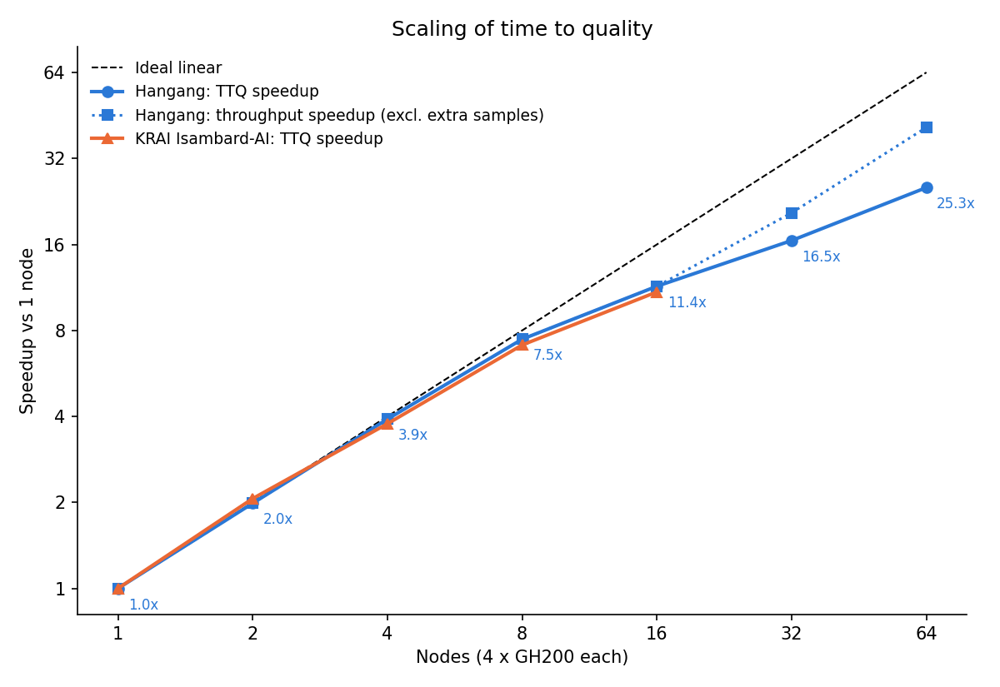

# Results

All Hangang numbers are **single runs** measured between Oct 31 and Nov 1, 2026.
KRAI numbers are the official MLPerf Training v6.0 scores recomputed from the published logs
with `tools/krai_baseline.py` (10 runs, fastest and slowest dropped, mean of 8).
Raw data: [`results/hangang_runs.csv`](../results/hangang_runs.csv),
[`results/krai_isambard_baseline.csv`](../results/krai_isambard_baseline.csv).

## 1. Best configuration per scale

| Nodes | GPUs | TP | CP | MINIBS | GBS | Converged at (samples) | TTQ (min) | Speedup vs 1 node | Efficiency |
|---:|---:|---:|---:|---:|---:|---:|---:|---:|---:|
| 1 | 4 | 4 | 1 | 8 | 8 | 3072 | 61.856 | 1.00x | - |
| 2 | 8 | 4 | 1 | 4 | 8 | 3072 | 31.143 | 1.99x | 99.3% |
| 4 | 16 | 4 | 1 | 2 | 8 | 3072 | 15.800 | 3.92x | 97.9% |
| 8 | 32 | 4 | 1 | 1 | 8 | 3072 | 8.298 | 7.45x | 93.2% |
| 16 | 64 | 4 | 2 | 1 | 8 | 3072 | 5.415 | 11.42x | 71.4% |
| 32 | 128 | 4 | 2 | 1 | 16 | 3840 | 3.746 | 16.51x | 51.6% |
| 64 | 256 | 4 | 2 | 1 | 32 | 4992 | 2.445 | 25.30x | 39.5% |

All runs: LR 0.00055, MAX_STEPS 800 (cosine schedule length), FP8, CUDA graphs on,
TP communication overlap off, NCCL over Slingshot CXI (from 2 nodes).

The dotted line ("throughput speedup") multiplies the TTQ speedup by the extra samples
needed at larger GBS (3840/3072 at 32 nodes, 4992/3072 at 64 nodes). The gap between the
two blue lines is the convergence cost of a larger global batch.

Training throughput (excluding evaluation): 0.931 samples/s on 1 node,
1.858 on 2 nodes, ~20.1 on 32 nodes, 40.4 on 64 nodes.

## 2. Comparison with KRAI (Isambard-AI)

| Nodes | KRAI GBS | KRAI score (min) | KRAI throughput | KRAI efficiency | Hangang TTQ (min) | Hangang efficiency |
|---:|---:|---:|---:|---:|---:|---:|
| 1 | 8 | 64.726 | 0.888 | - | 61.856 | - |
| 2 | 8 | 31.375 | 1.775 | 103.2%* | 31.143 | 99.3% |
| 4 | 8 | 17.162 | 3.479 | 94.3% | 15.800 | 97.9% |
| 8 | 8 | 9.097 | 6.775 | 88.9% | 8.298 | 93.2% |
| 16 | 16 | 5.933 | 12.930 | 68.2% | 5.415 (GBS 8) | 71.4% |

\* 3 of KRAI's 10 runs converged early (2688 samples).

Notes:

* The 1-node gap (~4-5% in throughput) is consistent with the 120 GB GH200 variant's higher
  HBM bandwidth. The gap grows with node count (8-9% at 4-16 nodes).
* **16 nodes:** KRAI's published config (`MINIBS=1`, `CP=2`) yields GBS 8 with the
  NVIDIA v5.0 formula `GBS = MINIBS * (GPUs / (TP*PP)) / CP`, but KRAI's logs report GBS 16.
  Hangang used the published files and got GBS 8. For a like-for-like comparison at
  GBS 16, see run E2 below (7.022 min, single run; KRAI's GBS 16 runs vary from 3456 to 5376
  samples).
* KRAI's NCCL transport on Isambard-AI cannot be determined from the public logs.

## 3. All runs

| Job | Nodes | Config | GBS | Net | Result |
|---|---:|---|---:|---|---|
| 1192108 | 1 | TP4 MINIBS8 | 8 | - | 61.856 min, 3072 samples |
| 1192315 | 2 | TP4 MINIBS4 | 8 | A (TCP) | 31.557 min, 3072 |
| 1192316 | 2 | TP4 MINIBS4 | 8 | C (CXI) | 31.143 min, 3072 |
| 1192544 | 4 | TP4 MINIBS2 | 8 | C | 15.800 min, 3072 |
| 1192539 | 8 | TP4 MINIBS1 | 8 | C | 8.298 min, 3072 |
| 1192541 | 16 | TP4 CP2 MINIBS1 | 8 | C | **5.415 min**, 3072 |
| 1192728 | 16 | TP4 CP2 MINIBS2 (E2) | 16 | C | 7.022 min, 4224 |
| 1192823 | 16 | TP4 CP1 MINIBS1 (E1) | 16 | C | 5.780 min, 4224 |
| 1192909 | 32 | TP4 CP2 MINIBS1 | 16 | C | **3.746 min**, 3840 |
| 1192835 | 32 | TP4 CP4 (a2a) MINIBS1 | 8 | C | failed: heads not divisible by CP |
| 1193001 | 64 | TP4 CP2 MINIBS1 | 32 | C | hang before warmup (shared Triton cache) |
| 1193066 | 64 | TP4 CP2 MINIBS1 | 32 | C | **2.445 min**, 4992 |

### Evaluation loss curves (target 0.925)

| Samples | n1 | n2 C | n4 | n8 | n16 GBS8 | n16 E2 GBS16 | n16 E1 GBS16 | n32 GBS16 | n64 GBS32 |
|---:|---|---|---|---|---|---|---|---|---|
| 1536 | 0.9367 | 0.9393 | 0.9389 | 0.9383 | 0.9381 | | | | |
| 1920 | 0.9334 | 0.9344 | 0.9361 | 0.9352 | 0.9368 | 0.9385 | 0.9457 | 0.9431 | |
| 2304 | 0.9351 | 0.9282 | 0.9296 | 0.9335 | 0.9298 | 0.9324 | 0.9372 | 0.9329 | |
| 2688 | 0.9265 | 0.9259 | 0.9259 | 0.9302 | 0.9272 | 0.9325 | 0.9343 | 0.9288 | 0.9395 |
| 3072 | **0.9223** | **0.9227** | **0.9233** | **0.9234** | **0.9223** | 0.9277 | 0.9317 | 0.9309 | 0.9363 |
| 3456 | | | | | | 0.9256 | 0.9288 | 0.9266 | 0.9317 |
| 3840 | | | | | | 0.9252 | 0.9264 | **0.9240** | 0.9297 |
| 4224 | | | | | | **0.9222** | **0.9245** | | 0.9262 |
| 4608 | | | | | | | | | 0.9267 |
| 4992 | | | | | | | | | **0.9237** |

## 4. 16-node design study

| Run | CP | MINIBS | GBS | Samples | Avg throughput incl. eval | TTQ |
|---|---:|---:|---:|---:|---:|---:|
| baseline | 2 | 1 | 8 | 3072 | 9.46 | **5.415** |
| E1 | 1 | 1 | 16 | 4224 | 12.38 | 5.780 |
| E2 | 2 | 2 | 16 | 4224 | 10.03 | 7.022 |

* Same GBS (E1 vs E2): dropping inter-node CP raises throughput by ~21-24%.
* Same CP (baseline vs E2): GBS 16 needs 37.5% more samples at LR 0.00055.
* Net effect at 16 nodes: keeping GBS 8 is best.

## 5. NCCL transport test (2 nodes, 8 GPUs, all-reduce bus bandwidth)

| Mode | 1 MB | 16 MB | 128 MB | 512 MB | NCCL network |
|---|---:|---:|---:|---:|---|
| A: image as-is | 1.22 | 9.63 | 9.74 | 11.87 GB/s | Socket (`bond0` + `hsn0-3`) |
| B: socket on `hsn*` only | 1.13 | 11.24 | 13.59 | 13.21 GB/s | Socket (`hsn0-3`) |
| C: host Cray libfabric | **5.90** | **74.97** | **156.03** | **178.61 GB/s** | AWS Libfabric, provider `cxi`, 4 NICs |

Despite the ~15x bandwidth gap, 2-node TTQ was 31.557 min (A) vs 31.143 min (C): with TP
inside the node, only small LoRA gradients and FP8 amax reductions cross nodes.

## 6. Earlier home-built container (for reference)

| Config | 1 node | 2 nodes |
|---|---:|---:|
| Custom NeMo/Megatron FP8 container, TP overlap off | 72.530 min | 133.213 min (inverse scaling) |
| This repo (NVIDIA v5.0 recipe + KRAI configs) | 61.856 min | 31.143 min |
